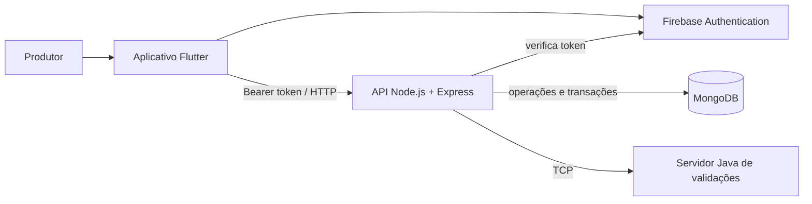

# Arquitetura do Sentinela

## Visão geral

O Sentinela utiliza um aplicativo Flutter, Firebase Authentication, uma API Node.js/TypeScript, MongoDB Atlas e um serviço Java de validação de domínio.



## Componentes

| Componente | Responsabilidade |
|---|---|
| Flutter (`lib/`) | Interface, autenticação do usuário, navegação e chamadas HTTP. |
| Firebase Authentication | Criação de credenciais e emissão de tokens de autenticação. |
| API Node/TypeScript (`backend/`) | Rotas HTTP, autorização, schemas Zod, regras de integração e persistência. |
| Serviço Java (`servidor-java/`) | Validações de regras de domínio por protocolo TCP. |
| MongoDB (`database/`) | Armazenamento, validadores de coleção e índices. |

## Fluxo de uma operação autenticada

1. O usuário autentica no Firebase pelo aplicativo Flutter.
2. O Flutter obtém o token Firebase e o envia no cabeçalho `Authorization: Bearer <token>`.
3. A API valida o token, identifica o usuário e verifica sua autorização.
4. A API valida o formato da entrada com Zod e consulta o Java quando a regra de domínio exige isso.
5. A API persiste a operação no MongoDB; operações relacionadas podem usar transação.
6. A API devolve uma resposta JSON ao aplicativo.

## Organização da API

```text
routes → validação Zod → controller → service → repository/Mongoose → MongoDB
                                   ↓
                         serviço de validação Java
```

- `modules/`: funcionalidades por domínio, como autenticação, propriedades, talhões e ocorrências.
- `middlewares/`: autenticação, validação de corpo e tratamento seguro de erros.
- `config/`: ambiente, Firebase, banco, questionário e comunicação Java.
- `shared/`: erros, idempotência e protocolos compartilhados.

## Decisões importantes

- O Firebase é responsável por credenciais; senhas não são armazenadas no MongoDB.
- O backend identifica o usuário a partir do token, não de um ID enviado livremente pelo cliente.
- O Java valida regras específicas; ele não substitui a autorização, as referências nem a persistência executadas pela API.
- O MongoDB garante estrutura e índices, mas regras entre documentos continuam responsabilidade da aplicação.
- O Firebase Auth Emulator pode ser usado no desenvolvimento local.

## Limitações atuais

Existem telas e validadores para mais fluxos do que integrações visuais comprovadas. A documentação de evidências deve ser consultada antes de afirmar que um fluxo foi demonstrado de ponta a ponta.
