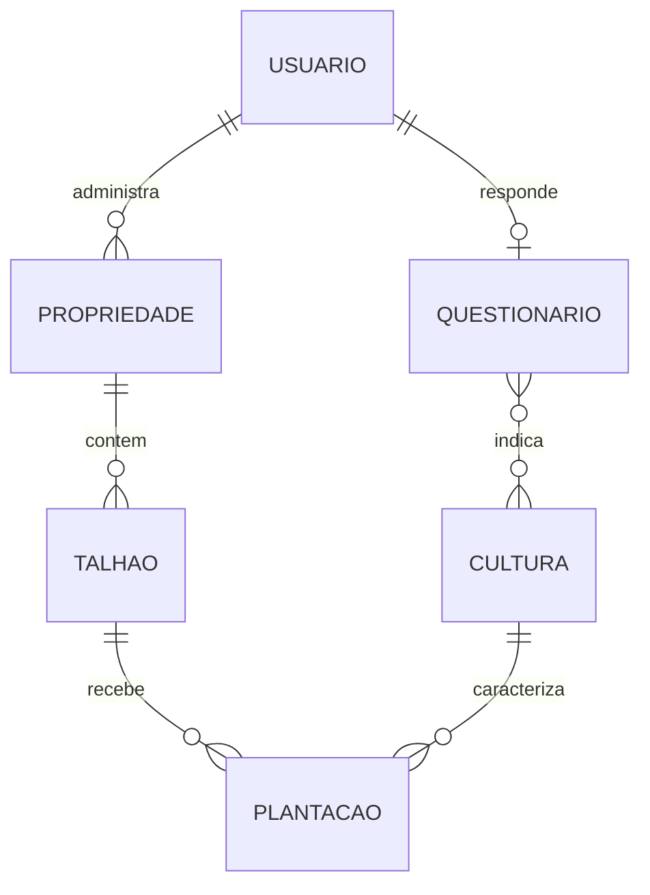
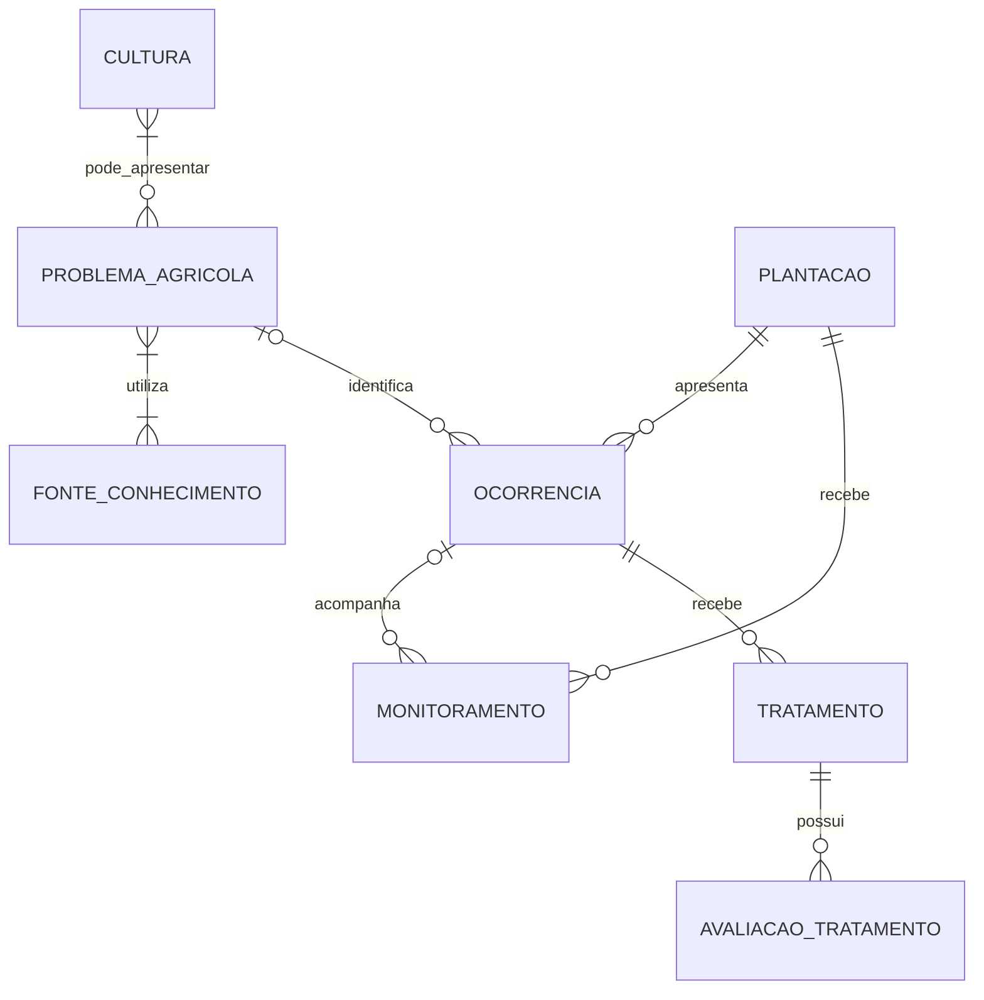
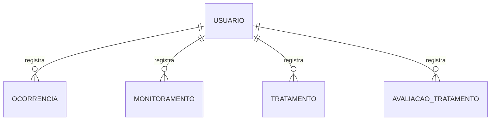
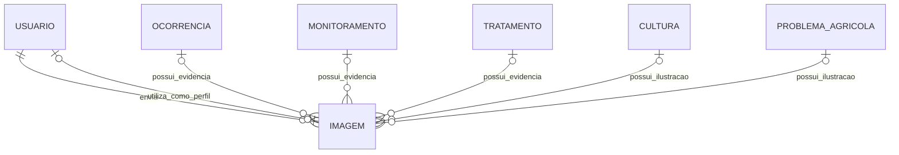
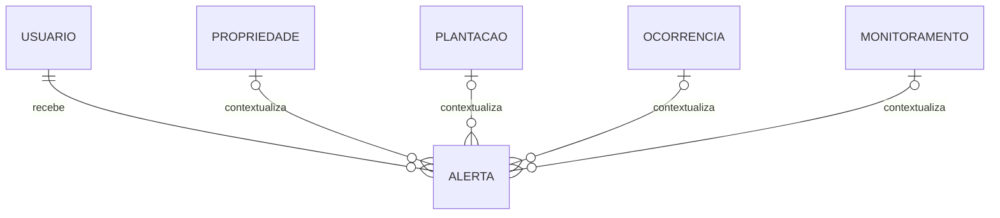

# Modelagem conceitual do banco de dados do Sentinela

## 1. Objetivo

Representar as entidades, os atributos, os identificadores e os relacionamentos do Sentinela, com base no levantamento de dados da etapa BD1.

## 2. Entidades e atributos

Os identificadores são conceituais. Seus tipos técnicos serão definidos na modelagem do MongoDB.

| Entidade | Identificador | Principais atributos |
|---|---|---|
| Usuário | idUsuario | Nome completo, identificador Firebase, CPF, telefone, preferência de contato, versão e data de aceite dos termos |
| Questionário | idQuestionario | Versão, porte declarado da propriedade, faixa de quantidade de culturas, outra cultura, problemas frequentes, frequência dos problemas, identificação autônoma e data de conclusão |
| Propriedade | idPropriedade | Nome, município, estado, área total, localização, observações e situação |
| Talhão | idTalhao | Nome, área, localização, observações e situação |
| Cultura | idCultura | Nome, nome científico, descrição e situação |
| Plantação | idPlantacao | Variedade, safra, data de plantio, área plantada, situação e data de encerramento |
| Problema agrícola | idProblema | Nome comum, nome científico, tipo, descrição, sintomas, partes afetadas, condições favoráveis, disseminação, prevenção e formas de controle |
| Ocorrência | idOcorrencia | Data de observação, tipo informado, sintomas, intensidade, área afetada, localização, situação, data e motivo de encerramento |
| Monitoramento | idMonitoramento | Data da observação, problema observado, observações, intensidade, evolução, área afetada, localização e próxima inspeção |
| Tratamento | idTratamento | Tipo de medida, descrição, data de aplicação, área tratada, produto, quantidade, unidade, responsável pela aplicação e observações |
| Avaliação de tratamento | idAvaliacao | Data da avaliação, resultado observado e observações |
| Imagem | idImagem | URL, identificador no Cloudinary, legenda e data de envio |
| Fonte de conhecimento | idFonte | Título, instituição ou autor, URL, data de publicação e data de acesso |
| Alerta | idAlerta | Tipo, título, mensagem, prioridade, motivo de geração, data de criação, leitura e expiração |

As entidades cujos registros podem ser alterados também terão datas de criação e atualização, conforme o levantamento.

## 3. Relacionamentos e cardinalidades

- 0..1: zero ou um.
- 1: exatamente um.
- 0..N: zero ou vários.
- 1..N: um ou vários.

| Relacionamento | Regra |
|---|---|
| Usuário responde Questionário | Um usuário possui 0..1 questionário; cada questionário pertence a 1 usuário |
| Questionário indica Cultura | Um questionário indica 0..N culturas do catálogo; uma cultura aparece em 0..N questionários |
| Usuário administra Propriedade | Um usuário administra 0..N propriedades; cada propriedade possui 1 responsável |
| Propriedade contém Talhão | Uma propriedade contém 0..N talhões; cada talhão pertence a 1 propriedade |
| Talhão recebe Plantação | Um talhão possui 0..N plantações ao longo do tempo; cada plantação pertence a 1 talhão |
| Cultura caracteriza Plantação | Uma cultura aparece em 0..N plantações; cada plantação possui 1 cultura |
| Problema agrícola afeta Cultura | Um problema afeta 1..N culturas; uma cultura pode ter 0..N problemas cadastrados |
| Plantação apresenta Ocorrência | Uma plantação possui 0..N ocorrências; cada ocorrência pertence a 1 plantação |
| Ocorrência identifica Problema agrícola | Uma ocorrência identifica 0..1 problema conhecido; um problema pode aparecer em 0..N ocorrências |
| Plantação recebe Monitoramento | Uma plantação possui 0..N monitoramentos; cada monitoramento pertence a 1 plantação |
| Monitoramento acompanha Ocorrência | Um monitoramento acompanha 0..1 ocorrência; uma ocorrência recebe 0..N monitoramentos |
| Ocorrência recebe Tratamento | Uma ocorrência recebe 0..N tratamentos; cada tratamento pertence a 1 ocorrência |
| Tratamento possui Avaliação | Um tratamento possui 0..N avaliações; cada avaliação pertence a 1 tratamento |
| Problema agrícola utiliza Fonte | Um problema utiliza 1..N fontes; uma fonte fundamenta 1..N problemas |
| Usuário registra Ocorrência | Um usuário registra 0..N ocorrências; cada ocorrência possui 1 autor |
| Usuário registra Monitoramento | Um usuário registra 0..N monitoramentos; cada monitoramento possui 1 autor |
| Usuário registra Tratamento | Um usuário registra 0..N tratamentos; cada tratamento possui 1 autor |
| Usuário registra Avaliação | Um usuário registra 0..N avaliações; cada avaliação possui 1 autor |
| Usuário envia Imagem | Um usuário envia 0..N imagens; cada imagem possui 1 remetente |
| Usuário recebe Alerta | Um usuário recebe 0..N alertas; cada alerta possui 1 destinatário |

### 3.1 Imagens

Uma ocorrência, monitoramento, tratamento, cultura ou problema agrícola pode possuir 0..N imagens.

Um usuário pode possuir 0..1 imagem como foto de perfil.

Cada imagem possui exatamente um contexto de uso entre esses elementos. O remetente da imagem pode ser um produtor ou um usuário autorizado a manter a base de conhecimento.

### 3.2 Alertas

Cada alerta possui exatamente um contexto principal: propriedade, plantação, ocorrência ou monitoramento.

Cada elemento desses pode estar relacionado a 0..N alertas.

### 3.3 Restrições complementares

- Um monitoramento vinculado a uma ocorrência deve pertencer à mesma plantação.
- A ocorrência pode ser registrada sem identificação específica do problema.
- O questionário pode indicar somente uma cultura informada em texto quando a opção “Outro” for utilizada, sem vínculo obrigatório com o catálogo.
- A autoria de uma ação não substitui a responsabilidade pela propriedade.
- A existência de várias plantações no talhão não implica autorização automática para cultivos simultâneos; essa regra precisa ser confirmada.

## 4. Diagramas conceituais

Os diagramas representam partes do mesmo modelo. As relações de imagens e alertas possuem restrições de exclusividade descritas na seção 3.

### 4.1 Usuários e organização dos cultivos

### 4.2 Problemas e acompanhamento

### 4.3 Autoria dos registros

### 4.4 Imagens

As relações abaixo são alternativas de contexto. Cada imagem deve participar de exatamente uma relação de uso, além da relação com seu remetente.

### 4.5 Alertas

As relações de contexto são alternativas: cada alerta se relaciona a exatamente um dos quatro elementos.

## 5. Decisões de modelagem

As decisões abaixo foram aceitas por Julia como base do modelo e devem ser revisadas pela equipe.

| Decisão | Justificativa |
|---|---|
| Cada propriedade possui um responsável | Simplificar a gestão inicial de acesso |
| Um usuário pode administrar várias propriedades | Atender produtores com mais de uma propriedade |
| Cada plantação possui uma cultura e pertence a um talhão | Identificar o cultivo e preservar o histórico entre períodos |
| Monitoramentos podem existir sem ocorrência | Permitir inspeções sem problema encontrado |
| Cada tratamento pertence a uma ocorrência | Simplificar o registro e acompanhamento |
| Tratamentos podem receber várias avaliações | Registrar resultados em diferentes datas |
| Manter apenas o questionário atual | Não existe necessidade confirmada de histórico das respostas |
| Cada imagem possui um único contexto de uso | Facilitar o gerenciamento de arquivos e vínculos |
| Fontes de conhecimento podem ser compartilhadas entre problemas | Evitar repetição de publicações |
| Histórico e dashboard não são entidades próprias | São obtidos por consultas aos registros |
| Alertas possuem um contexto principal | Evitar vínculos contraditórios |
| A identificação informada pelo produtor não confirma um diagnóstico | Não existe fluxo de confirmação definido |

A representação de questionário, imagem, avaliação e fonte como entidades não determina que cada uma terá uma coleção própria no MongoDB.

