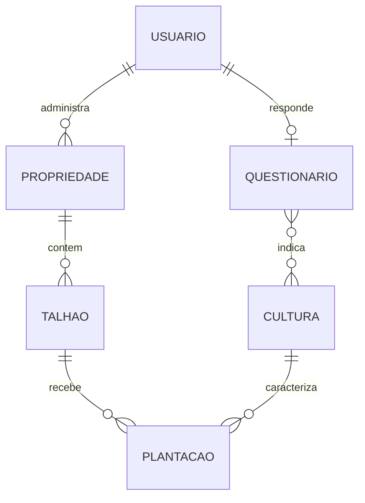
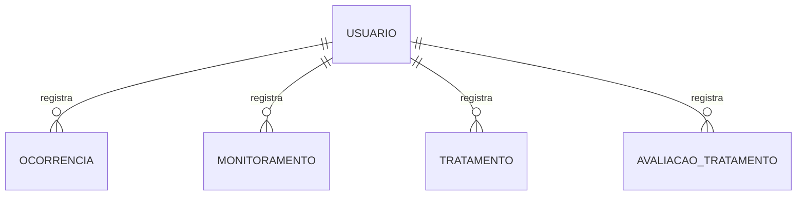
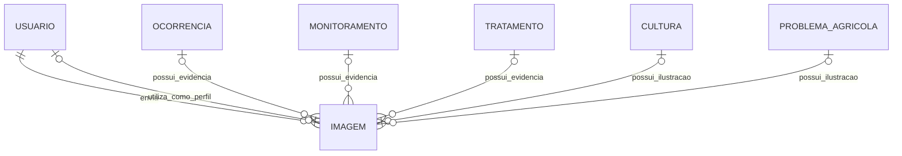
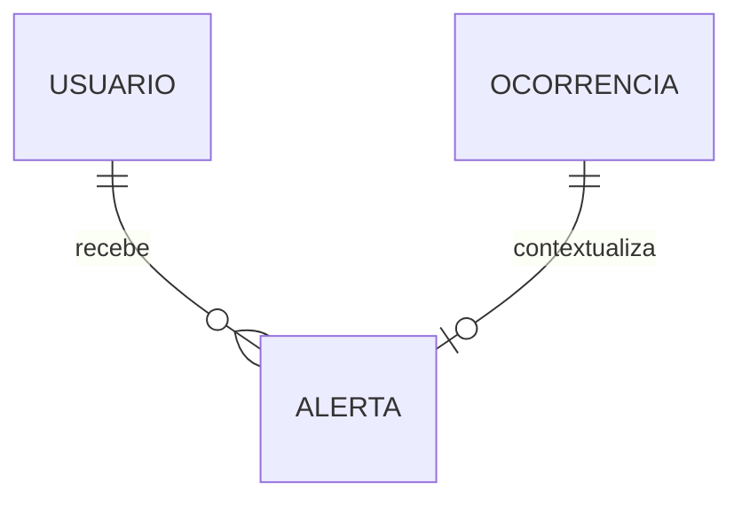
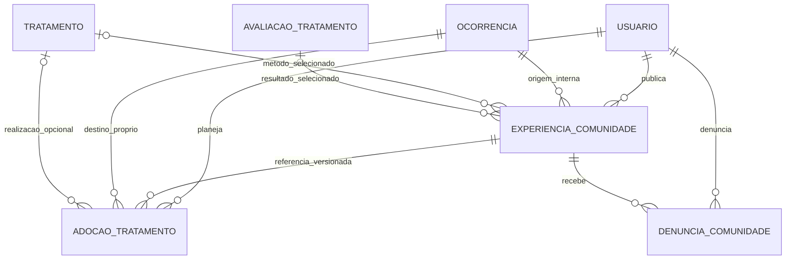

# Modelagem conceitual do banco de dados do Sentinela

## 1. Objetivo

Representar as entidades, os atributos, os identificadores e os relacionamentos do Sentinela, com base no levantamento de dados da etapa BD1.

## 2. Entidades e atributos

Os identificadores são conceituais. Seus tipos técnicos serão definidos na modelagem do MongoDB.

| Entidade | Identificador | Principais atributos |
|---|---|---|
| Usuário | idUsuario | Nome completo, identificador Firebase, CPF obrigatório, telefone, canal preferido para código, versão e data de aceite dos termos |
| Experiência da Comunidade | idExperiencia | Nome público copiado, cultura, problema/tipo, status relatado, título, relato, fotos selecionadas, método, resultado opcional, região opcional, versão, moderação e datas |
| Adoção de método | idAdocao | Experiência e versão, método copiado, ocorrência de destino, planejamento, situação, tratamento realizado opcional e datas |
| Denúncia | idDenuncia | Experiência, denunciante, motivo, descrição opcional, análise, decisão e datas |
| Questionário | Sem identificador próprio na BD3; acesso pelo usuário | Versão, porte declarado da propriedade, faixa de quantidade de culturas, outra cultura, problemas frequentes, frequência dos problemas, identificação autônoma e data de conclusão |
| Propriedade | idPropriedade | Nome, município, estado, área total, observações e situação |
| Talhão | idTalhao | Nome, área, observações e situação |
| Cultura | idCultura | Nome, nome científico, descrição e situação |
| Plantação | idPlantacao | Variedade, safra, data de plantio, área plantada, situação e data de encerramento |
| Problema agrícola | idProblema | Nome comum, nome científico, tipo, descrição, sintomas, partes afetadas, condições favoráveis, disseminação, prevenção e formas de controle |
| Ocorrência | idOcorrencia | Data de observação, tipo informado, sintomas, intensidade, área afetada, situação, data e motivo de encerramento |
| Monitoramento | idMonitoramento | Data da observação, problema observado, observações, intensidade, evolução, área afetada e próxima inspeção |
| Tratamento | idTratamento | Tipo de medida, descrição, data de aplicação, área tratada, produto, quantidade, unidade, responsável pela aplicação e observações |
| Avaliação de tratamento | idAvaliacao | Data da avaliação, resultado observado e observações |
| Imagem | Sem identificador próprio na BD3; publicId identifica o recurso externo | URL, identificador no Cloudinary, legenda e data de envio |
| Fonte de conhecimento | idFonte | Título, instituição ou autor, URL, data de publicação e data de acesso |
| Alerta | idAlerta | Tipo, título, mensagem, prioridade, data de criação, leitura e expiração |

Na proposta atual da BD3, questionário e imagens são incorporados, sem identificador próprio ou coleção adicional. O questionário é acessado pelo usuário ao qual pertence; `publicId` identifica o recurso externo da imagem no Cloudinary. Uma fonte pode ser cadastrada antes de qualquer vínculo, mas cada problema agrícola continua exigindo uma ou mais fontes.

As entidades cujos registros podem ser alterados também terão datas de criação e atualização, conforme o levantamento.

## 3. Relacionamentos e cardinalidades

- 0..1: zero ou um.
- 1: exatamente um.
- 0..N: zero ou vários.
- 1..N: um ou vários.

| Relacionamento | Regra |
|---|---|
| Usuário responde Questionário | Um usuário possui 0..1 questionário; cada questionário pertence a 1 usuário |
| Questionário indica Cultura | Um questionário indica 0..N culturas do catálogo; uma cultura aparece em 0..N questionários |
| Usuário administra Propriedade | Um usuário administra 0..N propriedades; cada propriedade possui 1 responsável |
| Propriedade contém Talhão | Uma propriedade contém 0..N talhões; cada talhão pertence a 1 propriedade |
| Talhão recebe Plantação | Um talhão possui 0..N plantações ao longo do tempo; cada plantação pertence a 1 talhão |
| Cultura caracteriza Plantação | Uma cultura aparece em 0..N plantações; cada plantação possui 1 cultura |
| Problema agrícola afeta Cultura | Um problema afeta 1..N culturas; uma cultura pode ter 0..N problemas cadastrados |
| Plantação apresenta Ocorrência | Uma plantação possui 0..N ocorrências; cada ocorrência pertence a 1 plantação |
| Ocorrência identifica Problema agrícola | Uma ocorrência identifica 0..1 problema conhecido; um problema pode aparecer em 0..N ocorrências |
| Plantação recebe Monitoramento | Uma plantação possui 0..N monitoramentos; cada monitoramento pertence a 1 plantação |
| Monitoramento acompanha Ocorrência | Um monitoramento acompanha 0..1 ocorrência; uma ocorrência recebe 0..N monitoramentos |
| Ocorrência recebe Tratamento | Uma ocorrência recebe 0..N tratamentos; cada tratamento pertence a 1 ocorrência |
| Tratamento possui Avaliação | Um tratamento possui 0..N avaliações; cada avaliação pertence a 1 tratamento |
| Problema agrícola utiliza Fonte | Um problema utiliza 1..N fontes; uma fonte fundamenta 0..N problemas |
| Usuário registra Ocorrência | Um usuário registra 0..N ocorrências; cada ocorrência possui 1 autor |
| Usuário registra Monitoramento | Um usuário registra 0..N monitoramentos; cada monitoramento possui 1 autor |
| Usuário registra Tratamento | Um usuário registra 0..N tratamentos; cada tratamento possui 1 autor |
| Usuário registra Avaliação | Um usuário registra 0..N avaliações; cada avaliação possui 1 autor |
| Usuário envia Imagem | Um usuário envia 0..N imagens; cada imagem possui 1 remetente |
| Usuário recebe Alerta | Um usuário recebe 0..N alertas; cada alerta possui 1 destinatário |

### 3.1 Imagens

Uma ocorrência, monitoramento, tratamento ou problema agrícola pode possuir 0..N imagens, respeitando os limites operacionais da BD4. Cada cultura possui 0..1 imagem representativa, como objeto opcional; sem ela, o aplicativo poderá exibir uma imagem padrão sem exigir seu armazenamento.

Um usuário pode possuir 0..1 imagem como foto de perfil.

Cada imagem possui exatamente um contexto de uso entre esses elementos. O remetente da imagem pode ser um produtor ou um usuário autorizado a manter a base de conhecimento.

### 3.2 Alertas

As intensidades permanecem `baixa`, `media` e `alta`. A aplicação gera um alerta somente no cadastro de uma ocorrência com intensidade `alta`, com tipo `ocorrencia_intensidade_alta`. O destinatário é o responsável pela propriedade, obtido pelo vínculo ocorrência → plantação → talhão → propriedade → usuário responsável. O contexto é a ocorrência cadastrada. A exibição ocorre somente dentro do aplicativo, sem envio por e-mail, SMS ou notificação push. Deve existir apenas um alerta desse tipo por ocorrência, inclusive em tentativas repetidas. Alterações posteriores de intensidade e registros de monitoramento não geram esse alerta. A aplicação gera o alerta; o MongoDB apenas o armazena e aplica as restrições configuradas.

Título e mensagem descrevem o alerta. `lidoEm` permanece opcional e `regraOrigem` não será incluído. Cada alerta possui exatamente uma ocorrência como contexto; uma ocorrência possui 0..1 alerta desse tipo.

### 3.3 Restrições complementares

Todas as áreas são informadas manualmente em hectares, sem necessidade de coordenadas, e devem ser números positivos e finitos quando preenchidas. A área total da propriedade não equivale à área cultivada. A área plantada não pode ultrapassar a área do talhão; a aplicação confere essa comparação entre documentos, enquanto o MongoDB valida o tipo numérico e a positividade. O porte do questionário permanece declaratório, sem cálculo automático com base na área.

| Atributo conceitual | Campo na BD3 | Tipo | Obrigatoriedade |
|---|---|---|---|
| Área total da propriedade | propriedades.areaTotalHa | Número | Opcional |
| Área do talhão | talhoes.areaHa | Número | Obrigatório |
| Área plantada | plantacoes.areaPlantadaHa | Número | Opcional |

A análise da distribuição das áreas e os indicadores de área afetada são possibilidades futuras. Estão fora do escopo desta versão e exigem requisitos específicos para novos campos, cálculos, índices ou restrições. Eventuais indicadores deverão ter sua definição e interpretação discutidas antes da implementação; não somar registros de área afetada como se representassem necessariamente áreas distintas.

- O porte informado no questionário é declaratório, com as opções pequena, média e grande (`pequena`, `media` e `grande` no MongoDB). Não será calculado automaticamente pela área nem apresentado como classificação oficial. A resposta não será usada para impor restrições de área ou de quantidade de propriedades. Essa regra está definida e não constitui pendência de modelagem.

- CPF é obrigatório, conforme a tela existente, e corresponde a `cpf` na BD3: String de 11 dígitos, sem pontuação. A aplicação valida os dígitos verificadores. Não definir índice único para CPF sem decisão específica.
- O canal preferido corresponde a `canalCodigoPreferido`, String com valores `sms` ou `email`, obrigatório ao concluir a etapa de escolha do canal. Esse atributo registra somente a escolha; envio e verificação pertencem à autenticação. Não armazenar códigos de verificação no perfil do MongoDB.
- A viabilidade do envio por ambos os canais ainda precisa ser conferida na implementação da autenticação.

- Um monitoramento vinculado a uma ocorrência deve pertencer à mesma plantação.
- A ocorrência pode ser registrada sem identificação específica do problema.
- O questionário pode indicar somente uma cultura informada em texto quando a opção “Outro” for utilizada, sem vínculo obrigatório com o catálogo.
- A autoria de uma ação não substitui a responsabilidade pela propriedade.
- Cada talhão pode ter várias plantações ao longo do tempo, mas no máximo uma com status `ativa`. Para iniciar outra plantação no mesmo talhão, a atual deverá estar encerrada. Cultivos simultâneos, consorciados e áreas sobrepostas ficam fora do escopo desta versão. O histórico das plantações encerradas será preservado; a cardinalidade histórica talhão → plantações permanece 1:N, permitindo talhões ainda sem plantação.
- Plantações encerradas preservam todo o histórico para consulta autorizada, mas bloqueiam novas ocorrências, monitoramentos, tratamentos e avaliações de tratamento, inclusive lançamentos atrasados com data anterior ao encerramento. Edições e exclusões dos registros privados vinculados ficam bloqueadas na operação comum do aplicativo; preservar os registros existentes. A permissão específica de copiar/editar experiências públicas está na seção 6 e não altera o registro privado. A aplicação verifica o estado da plantação por seus relacionamentos: ObjectIds e índices não garantem esses bloqueios. Procedimentos específicos de privacidade e tratamento de dados pessoais são distintos e dependem de política própria, sem remoção automática.
- A soma das áreas dos talhões ativos deve ser menor ou igual à área total da propriedade, quando informada. A aplicação verifica a regra ao criar, alterar ou reativar talhões e ao reduzir a área total, inclusive diante de operações concorrentes. A aplicação rejeita áreas não finitas; tipo e positividade no banco não substituem essa verificação.
- Problemas agrícolas mantêm os demais obrigatórios mesmo inativos. Ficha completa pendente de revisão exige ativo false e pode não ter data de revisão; aprovação exige data real. Legados sem estado editorial continuam estruturalmente válidos, sem aprovação automática pela API. A inativação controla novas seleções e preserva referências históricas. Seções da ficha, níveis qualitativos, classes/exemplos de controle e revisão são atributos incorporados detalhados na BD3 §5.6, sem novas entidades; até 4 chips. A primeira imagem é a principal, mantendo imagens opcionais.
- Novos tratamentos exigem plantação ativa e ocorrência `aberta` ou `em_acompanhamento`. Ocorrência `encerrada` bloqueia novos tratamentos, inclusive lançamentos atrasados; essa regra não presume resolução do problema.

### 3.4 Requisitos planejados para dados pessoais

CPF e telefone serão utilizados somente nas finalidades documentadas de cadastro e autenticação. O acesso aos dados pessoais será restrito ao próprio usuário e a pessoas autorizadas, conforme a função e a necessidade. CPF e telefone não deverão constar em alertas nem em logs da aplicação. Exemplos, testes e massa de dados deverão utilizar dados fictícios. A exclusão de conta ficará indisponível no aplicativo nesta versão. A política de retenção, anonimização e atendimento a solicitações de exclusão ainda deve ser definida; a ausência de exclusão automática não autoriza armazenamento permanente.

## 4. Diagramas conceituais

Os diagramas representam partes do mesmo modelo. As relações de imagens e alertas possuem restrições de exclusividade descritas na seção 3.

### 4.1 Usuários e organização dos cultivos

A relação entre talhão e plantações no diagrama representa o histórico. A restrição de no máximo uma plantação ativa não altera a cardinalidade histórica 1:N.

### 4.2 Problemas e acompanhamento

### 4.3 Autoria dos registros

### 4.4 Imagens

As relações abaixo são alternativas de contexto. Cada imagem deve participar de exatamente uma relação de uso, além da relação com seu remetente.

### 4.5 Alertas

No escopo atual, o alerta possui uma ocorrência como contexto e um usuário responsável como destinatário. A ocorrência pode não gerar alerta (intensidade baixa ou media), mas não pode gerar mais de um desse tipo.

## 5. Decisões de modelagem

As decisões abaixo constituem a base do modelo e devem ser revisadas pela equipe.

| Decisão | Justificativa |
|---|---|
| Adiar a geolocalização para uma versão futura | Reduzir o escopo do MVP e priorizar as funcionalidades principais |
| Cada propriedade possui um responsável | Simplificar a gestão inicial de acesso |
| Um usuário pode administrar várias propriedades | Atender produtores com mais de uma propriedade |
| Cada plantação possui uma cultura e pertence a um talhão | Identificar o cultivo e preservar o histórico entre períodos |
| Monitoramentos podem existir sem ocorrência | Permitir inspeções sem problema encontrado |
| Cada tratamento pertence a uma ocorrência | Simplificar o registro e acompanhamento |
| Tratamentos podem receber várias avaliações | Registrar resultados em diferentes datas |
| Manter apenas o questionário atual | Não existe necessidade confirmada de histórico das respostas |
| Cada imagem possui um único contexto de uso | Facilitar o gerenciamento de arquivos e vínculos |
| Fontes de conhecimento podem ser compartilhadas entre problemas | Evitar repetição de publicações |
| Histórico e dashboard não são entidades próprias | São obtidos por consultas aos registros |
| Um alerta de intensidade alta por ocorrência, destinado ao responsável pela propriedade | Evitar duplicidade e informar o responsável somente dentro do aplicativo |
| A identificação informada pelo produtor não confirma um diagnóstico | Não existe fluxo de confirmação definido |

Município e estado da propriedade permanecem no modelo, assim como os relacionamentos entre propriedade, talhão, plantação, ocorrência e monitoramento. Detalhes descritivos podem utilizar os campos de observações já existentes, sem novos atributos.

A representação de questionário, imagem, avaliação e fonte como entidades não determina que cada uma terá uma coleção própria no MongoDB.

O dashboard do MVP conta propriedades, talhões e plantações ativos, ocorrências por status e alertas não lidos, sempre dentro dos vínculos autorizados do usuário. O filtro opcional por propriedade afeta talhões, plantações e ocorrências; propriedades e alertas permanecem gerais. A contagem de ocorrências preserva o histórico, inclusive de propriedades e plantações encerradas. A BD3, seção 7.2, define os vínculos e filtros. Os rótulos são aberta, em acompanhamento e encerrada, mantendo os significados de `aberta`, `em_acompanhamento` e `encerrada`; não substituir por “em tratamento”/“resolvida”.

## 6. Comunidade: relações e cópias públicas

Regras confirmadas do MVP: acesso somente autenticado; feed pela primeira aprovação e identificador, sem reposicionamento por edição; conteúdo editado suspenso até nova aprovação; liberação de ocultação exclusiva de moderador após análise. Adoção segue planejada → realizada ou cancelada; criar o tratamento real exige manter o vínculo e marcar a adoção realizada. Para cada par experiência/ocorrência, há no máximo uma adoção planejada, independentemente de versão ou usuário, sem limitar o histórico de realizadas/canceladas. Denúncia segue pendente → analisada com decisão, sem ocultação automática.

O usuário possui nome público opcional no perfil, obrigatório ao enviar experiência. O nome é copiado para a publicação, sem expor automaticamente nome completo ou perfil privado. Município e UF da publicação são opcionais e não são obtidos automaticamente da propriedade. A lista de campos retornados publicamente é definida na BD3, seção 10.5.

| Relacionamento | Cardinalidade e condição |
|---|---|
| Usuário publica Experiência | Usuário 0..N experiências; cada experiência tem 1 autor |
| Experiência tem origem em Ocorrência | Ocorrência 0..N experiências; cada experiência tem 1 ocorrência própria de origem, referência interna |
| Experiência compartilha Tratamento | Experiência 0..1 tratamento; tratamento 0..N experiências; mesma ocorrência de origem |
| Experiência compartilha Avaliação | Experiência 0..1 avaliação; avaliação 0..N experiências; exige o tratamento de origem correspondente |
| Experiência relata Cultura/Problema | Exatamente 1 cultura; 0..1 problema cadastrado, com tipo relatado; rótulos públicos são copiados |
| Usuário registra Adoção | Usuário 0..N adoções; cada adoção tem 1 autor e 1 ocorrência própria de destino |
| Adoção referencia Experiência | Experiência 0..N adoções; cada adoção guarda 1 experiência, sua versão e cópia do método |
| Adoção vincula Tratamento realizado | Adoção 0..1 tratamento; não impor unicidade inversa sem regra específica. Avaliações permanecem vinculadas ao tratamento existente |
| Usuário denuncia Experiência | Cada denúncia tem 1 denunciante e 1 experiência; ambos podem ter 0..N denúncias |
| Equipe revisa Experiência/Denúncia | Responsável interno identificado quando houver decisão; acesso restrito à moderação |

Não há referência redundante a propriedade: origem e destino seguem ocorrência → plantação → talhão → propriedade. Experiência é uma cópia pública escolhida, não uma janela para o documento privado. Adoção é planejamento, não tratamento realizado; o resultado próprio continua em Avaliação de tratamento.

As três coleções propostas e seus enums operacionais estão nas seções 10 da BD3 e 14 da BD4. A compatibilidade de adoção pela mesma cultura e mesmo problema cadastrado foi confirmada; problemas não identificados não permitem adoção. Também foi permitido publicar cópias de experiências históricas e editar o conteúdo público mediante nova revisão, mesmo com plantação de origem encerrada, mantendo os documentos privados bloqueados. A plantação de destino da adoção deve permanecer ativa. Os demais detalhes técnicos dessas seções são propostas para revisão, não aprovação externa presumida. A revisão para a banca não equivale a validação profissional nem a política completa para operação pública.
